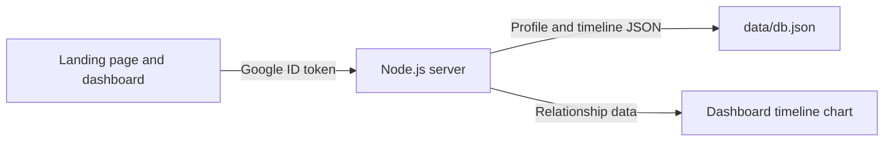

# Is Dating Her Okay?

I made this prototype to turn a familiar age-gap rule of thumb into something you can inspect over time: add fictional timeline entries and see them plotted against the formula. The timeline and chart make the assumptions visible, but a formula cannot answer questions of consent, safety, or legality. It’s an old experiment; fork it for a safer, better-defined visualization if you have one in mind.

The chart visualizes a formula. It does not establish consent, safety, or legal eligibility. Use fictional dates when trying this older local prototype.

## Features

- Google Identity Services sign-in landing page.
- Profile setup with birthdates stored on the server.
- Partner timeline management with start/end dates and optional notes.
- Dynamic scatter plot that adjusts its axes to the current dataset and overlays
  the divide-by-two-plus-seven guideline.
- Timeline table that highlights whether each relationship period was compliant
  and predicts the date when it becomes acceptable.
- Simple JSON-backed persistence (`data/db.json`) for sharing data across users.

## Getting started

1. Supply your own Google client ID in `public/index.html` (replace
   `YOUR_GOOGLE_CLIENT_ID`).
2. Install Node.js (18 or newer recommended).
3. Start the server:

   ```bash
   npm start
   ```

4. Visit `http://localhost:3000` in your browser.

## API overview

- `GET /api/me` &ndash; returns the signed-in user's profile. Requires
  `Authorization: Bearer <google_id_token>` header.
- `POST /api/me` &ndash; updates the profile (name, birthdate).
- `GET /api/partners` &ndash; returns the current user's partner timelines.
- `POST /api/partners` &ndash; creates a new partner timeline entry.
- `GET /api/relationships` &ndash; aggregated view of all timelines for the chart.

All data is persisted in `data/db.json`. In production you should replace this
with a real database and verify Google credentials server-side.

## Request flow



This is an older prototype. The server does not verify Google tokens, JSON storage is not suitable for concurrent production use, and the guideline is only a visualization. It is not a measure of consent, safety, or legal eligibility.
