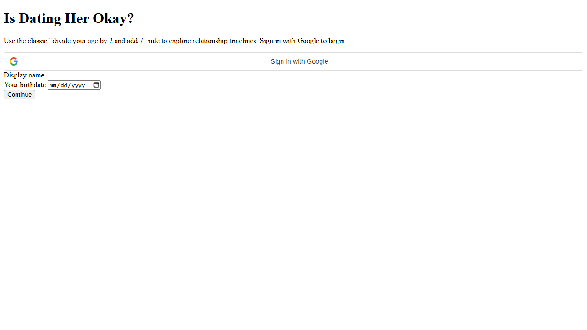

# Is Dating Her Okay?

> **Interactive age gap rule-of-thumb timeline inspector and formula visualizer.**

*Click the preview card above to watch the calculator walkthrough.*

---

## Why I Built This

People frequently reference the informal "Half-your-age-plus-7" dating rule of thumb, but rarely understand how the boundary condition shifts dynamically as both individuals age together over time.

This interactive web tool allows users to input any two ages and renders a comprehensive multi-decade timeline plotting minimum age boundaries, crossover milestones, and percentage convergence across life stages.

## Standout Features

- **Instant Formula Validation:** Evaluates partner age against the classic `(Age / 2) + 7` threshold instantly.
- **Multi-Decade Timeline Projection:** Charts compliance curves over a 60-year horizon, proving how age gaps become negligible with maturity.
- **Zero-Dependency Web App:** Lightweight, instantaneous client-side calculation with clean visual feedback.

## Media

- **UI Screenshot:** `media/overview.png`
- **Interactive Video:** `media/walkthrough.mp4`

## Running Locally

Open `public/index.html` in your browser.
